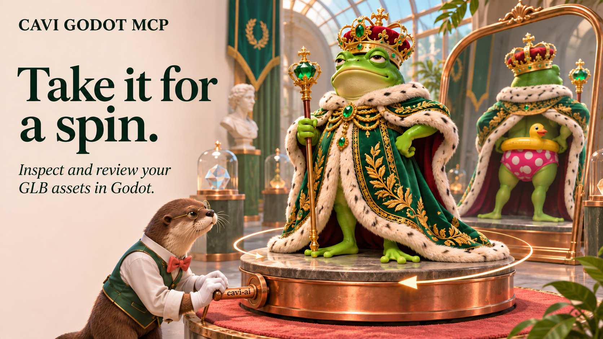

# Cavi Godot MCP



## Take it for a spin.

See your GLB as Godot imports it. Cavi Godot MCP helps your assistant inspect meshes, materials, skeletons and animation clips, then prepare a rendered view you can review together. Orbit a static asset or capture a selected animation pose without building a review scene by hand.

Try asking:

> Inspect my GLB in Godot. What meshes, materials and animation clips did it import? Prepare a three-quarter view so I can look it over.

## Set up

Native inspection and capture require macOS or Linux, Python 3.15 or newer, [uv](https://docs.astral.sh/uv/), a Godot editor and an existing workspace. Install the server:

```sh
uv tool install cavi-godot-mcp
```

Configure your MCP client with the executable and absolute paths. Inspection needs only the workspace and Godot paths:

```json
{
  "mcpServers": {
    "godot": {
      "command": "cavi-godot-mcp",
      "env": {
        "CAVI_GAME_ART_WORKSPACE": "/absolute/path/to/workspace",
        "CAVI_GODOT_BIN": "/absolute/path/to/godot"
      }
    }
  }
}
```

To capture a rendered view, also set `CAVI_GODOT_WEB_TEMPLATE`, `CAVI_CHROMIUM_BIN` and `CAVI_NODE_BIN` to absolute paths. Use a single-threaded Web export template matching your Godot editor, headless Chromium with WebGL 2 support, and Node.js 22 or newer.

## Review your asset

- Inspect a self-contained GLB for scene nodes, mesh surfaces, materials, UV presence, skeletons and clips.
- Sample an animation's node and skeleton transforms at selected times.
- Prepare and capture a static view, including texture-free and vertex-colored drafts before cleanup, or capture one selected pose from an animated GLB. Open the capture for visual review.
- Serve the exported review bundle locally to orbit and zoom; press R to reset the camera. A white bar marks one metre. Pose reviews open paused at the requested time. Play or pause the selected clip, scrub the timeline, or select Reset pose.

<details>
<summary>Operations, limits and recovery</summary>

`godot_asset_inspect` takes a workspace-relative `source` and a new workspace-relative `directory`. It accepts self-contained GLB 2.0 files up to 64 MiB. Its mesh bounds describe the imported rest pose; reports include totals and truncation flags for capped records. Inspection uses Godot's headless runtime importer and does not require a browser or Web template.

For motion, use the inspection report's player path and clip name with `godot_motion_inspect`. Supply 2–9 strictly increasing `normalized_times` between 0 and 1. The result measures node and skeleton transforms, not skinned surface deformation.

For a static review, `godot_review_prepare` takes the source, a new directory and `front`, `three-quarter` or `side` view. Static inputs cannot contain skins or animations. Textures are optional; any images must be embedded PNG or JPEG. Geometry-only static triangles without normals or materials use neutral shading for review. To review an animated asset, inspect it first and provide a selected `pose` with the reported player path, animation name and time in seconds. For matched comparisons, capture the larger asset first, then pass its returned `scene.camera_frame` as `framing` for the other asset at the same view. For static reviews, set `all_views` to capture all three angles in one session; the selected view remains `capture.png`, and the other angles use `capture-front.png`, `capture-three-quarter.png` or `capture-side.png`. `godot_review_capture` produces the frames, and `godot_review_inspect` checks source, tool and artifact hashes and reports the latest attempt.

To open the interactive view, serve the receipt's relative `bundle` within the review directory:

```sh
python3 -m http.server --bind 127.0.0.1 --directory <review-directory>/<bundle>
```

Stop the server after review. Godot's headless mode does not render; capture uses a Godot Web export with the Compatibility renderer and WebGL 2. The review does not establish gameplay, collision, traversal, room architecture or appearance in another engine. Perform final acceptance in the consuming engine.

If inspection fails, preserve its output directory and inspect the receipt and process logs before retrying. If a capture has an unknown outcome, use `godot_review_inspect` to examine the latest attempt. A pending cleanup marker blocks another capture; resolve the owned processes and output before removing it.

</details>

## Security

The server runs locally over MCP stdio. Report security concerns privately as described in [SECURITY.md](SECURITY.md).

## License

MIT. See [LICENSE](LICENSE).
